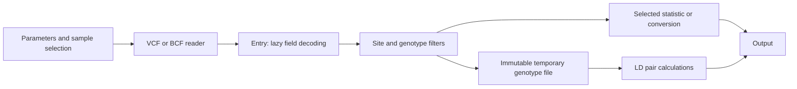

# NuVCFtools modules and execution flow

The default installation exposes 25 commands: the C++ `vcftools` executable and 24 Perl scripts. They have separate parsers and execution paths. The source tree is roughly 36,000 lines including bundled C code and tests, excluding documentation. Most implementation is concentrated in a few large files.

## C++ execution

[`vcftools.cpp`](../src/cpp/vcftools.cpp) parses parameters, constructs either `vcf_file` or `bcf_file`, applies sample selection, and dispatches the selected output function. The initial `variant_file::apply_filters` selects individuals. Record-level `entry::apply_filters` is a different operation, called inside each analysis loop.

[`variant_file.h`](../src/cpp/variant_file.h) combines the file interface with a large surface of statistics and conversion methods. Its two reader implementations supply VCF text and BCF bytes. [`entry.h`](../src/cpp/entry.h), `vcf_entry` and `bcf_entry` hold a record, decoded values and parse flags. Callers request the fields they need; repeated parsing can be avoided through those flags.

[`variant_file_output.cpp`](../src/cpp/variant_file_output.cpp) is about 5,800 lines. It contains per-record statistics, aggregate statistics, LD preparation, pairwise calculations and formatting. Many output functions independently implement the read/reset/filter loop. Conversions are mostly in [`variant_file_format_convert.cpp`](../src/cpp/variant_file_format_convert.cpp); two-file comparisons are in [`variant_file_diff.cpp`](../src/cpp/variant_file_diff.cpp).

LD already has a useful seam: serial input decoding/filtering writes an immutable genotype file, then a second stage computes pairs. [`ld_bitsets`](../src/cpp/ld_bitsets.h) owns the genotype/haplotype planes and integer moment counts. `ld_site_reader` owns its stream and bounded decoded-site cache. Genotype chi-square uses a separate two-byte-per-sample temporary representation and a numerical kernel in `calc_geno_chisq`.

## Perl execution

Most scripts use [`Vcf.pm`](../src/perl/Vcf.pm), a separate implementation of headers, records, FORMAT fields, genotype conversion and validation. It is not a wrapper around the C++ executable. Optimizing this module does not speed up C++ parsing.

| Command family | Default commands | Main shared implementation |
| --- | --- | --- |
| Selection, querying and annotation | `vcf-subset`, `vcf-query`, `vcf-annotate`, `vcf-contrast`, `vcf-shuffle-cols` | `Vcf.pm` plus command-specific logic |
| Multi-file operations | `vcf-merge`, `vcf-concat`, `vcf-isec`, `vcf-compare`, `vcf-phased-join` | `Vcf.pm`, ordered file heads and command-specific reducers |
| Summaries and validation | `vcf-stats`, `vcf-validator`, `vcf-indel-stats`, `vcf-tstv` | `VcfStats.pm`/`Vcf.pm`; `vcf-tstv` has its own small scanner |
| Filling, reference sequence and conversion | `fill-aa`, `fill-an-ac`, `fill-fs`, `fill-ref-md5`, `vcf-consensus`, `vcf-convert` | `Vcf.pm`, optional `FaSlice.pm` and external tools |
| Ordering and format maintenance | `vcf-sort`, `vcf-fix-newlines`, `vcf-fix-ploidy`, `vcf-to-tab` | GNU sort, direct text processing, or `Vcf.pm` |

[`VcfStats.pm`](../src/perl/VcfStats.pm) extends the reader with grouping and counters. [`FaSlice.pm`](../src/perl/FaSlice.pm) caches reference sequence chunks retrieved through `samtools faidx`. Some reference operations still launch `tabix` for every variant/mask query; `fill-fs::mask_sequence` is one concrete example.

`vcf-sort` already forwards a parallel-sort option to GNU sort. `vcf-validator -u` forks a child so the parent can collect and deduplicate diagnostics; it still has one validation worker. A subprocess does not by itself establish parallel computation.

## Where the measured gains came from

The [current comparison inventory](../benchmarks/current-vs-upstream.md) lists all retained tool optimizations, their latest available upstream measurements and the remaining measurement gaps. It distinguishes current-snapshot results from earlier verified revisions. The [earlier common-tool matrix](../benchmarks/common-tool-speed-20261126.md) contains 15 upstream/baseline/candidate task comparisons. It is not a remeasurement of every command and option. Earlier broad coverage comprises 69 C++ scenarios and 24 Perl commands; scenarios are not independent installed tools.

The main gains came from reducing repeated genotype parsing/classification, retaining fields as opaque text when they are not needed, compact LD representations, reusing decoded LD payloads, and buffering output files. The statistical formulas and per-pair floating-point operation order were retained in the tested paths.

Changes to a shared module can help commands whose entry script was untouched. For example, `fill-an-ac` calls `Vcf.pm::calc_an_ac`. Such indirect benefits require their own measurement; they are not counted as a newly measured speedup merely because the dependency changed.

## Common-tool follow-up

All retained changes now share `codex/common-tool-speed-round2`. The [larger-cohort report](../benchmarks/common-tools-20261126.md) covers `vcf-stats`, `--relatedness2` and `--relatedness`, separately from the LD benchmarks.

`--relatedness2` packs one machine word of accepted sites into genotype masks, then counts sample-pair contributions with bit operations. Homozygous allele IDs are bit-sliced rather than restricted to two hardcoded values. Its temporary genotype storage is bounded independently of the number of sites. Both relatedness estimators allocate their matrices only for retained samples; the Yang estimator preserves its original per-site floating-point addition order. These changes use one core.

`vcf-stats` reuses its genotype groups when updating shared/private and sample counters. A sample's multiplicity is distinct from the number of statistic destinations selected by filters. Its CLI uses `next_data_hash_readonly`, which shares equal neighboring genotype objects within one record. This interface requires read-only genotype hashes; the ordinary parser still returns independent mutable hashes.

## Parallel work

The C++ parser/filter path is not currently safe to run concurrently by constructing more `entry` objects. Shared mutable state includes:

- `header::int2str` and `double2str`: static string streams.
- `vcf_entry::parse_genotype_entry`: a static scratch string.
- `vcf_file::read_line(vector<char>&)`: a static scratch string.
- `entry` filters: static position sets, BED intervals, mask stream/cursor and thinning state.
- The global logger and its one-off-warning state.

Some filters also depend on record order. Floating-point aggregate reductions can change output bytes when their addition order changes.

The LD chi-square pair stage now supports `--ld-threads N`. Each worker owns its readers and an `ld_chisq_workspace`; the gamma coefficient table is immutable. Workers write framed temporary files, and the caller merges them in the original outer-site/inner-site order. This bounds RAM independently of the number of pairs, at the cost of temporary output proportional to the result size. Parsing/filtering remain serial. Other LD modes do not yet use this worker option.

The [500/2,504-sample comparison](../benchmarks/parallel-ld-20261126.md) includes worker setup, staging, temporary output and ordered writing. Eight workers reduced wall time by 3.61–3.89× relative to the preceding optimized one-core executable, with higher RSS. Default one-core execution was about 3% slower in these measurements. Upstream ratios and thread scaling are reported separately; the earlier 15-task matrix remains a record of its original single-core revisions.

For reference-based Perl commands, persistent readers and batching index queries should be measured before adding workers. For merge/intersection/concatenation, decompression of separate files can overlap, while the ordered reducer and its file-order rules remain explicit.

## Next implementation order

1. Keep the validated one-core changes as a reviewable baseline.
2. The chi-square kernel is isolated and its optional parallel stage is measured. Preserve its arithmetic and row order when changing it.
3. Investigate the remaining single-core overhead before considering a default change; other commands need their own measurements before adding workers.
4. Measure external-process overhead in reference filling and the remaining commands.
5. Extend the per-command matrix; do not infer unmeasured gains from shared code changes.

Latest remaining-tool audit and measured changes: [remaining Perl tools](../benchmarks/remaining-perl-20261127.md). The source-work inventory is now 19 targeted entrypoints and six untargeted since its recorded baseline; this is not a count of proven speedups.
